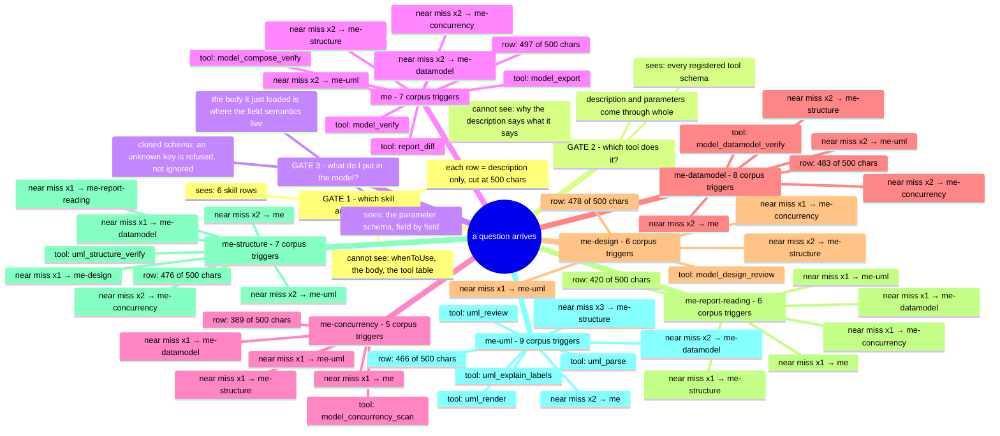

# Routing map

Generated by `docs/tools/generate-routing-map.mjs` from the routing corpus, the registered
tool definitions and the family table. Do not edit by hand: change the data and regenerate,
or the map starts describing a routing contract that no longer exists.

## The decision the model makes, and what it can see

## Who owns which question (from the corpus)

| Skill | Row length | Owns these questions | Sends the near miss to |
|---|---|---|---|
| `model-everything` | 497/500 | "the README says the API accepts a batch of 100, check that" "verify the claims in this design doc against the code" "this spec says a job can never be both queued and running - is that enforced?" | me-concurrency x2, me-datamodel x2, me-structure x2, me-uml x2 |
| `model-everything-concurrency` | 389/500 | "this design claims the queue is thread-safe and lock-free" "is this counter monotonic under concurrent writers?" "the doc says the ISR-safe path touches no shared memory" | me x1, me-datamodel x1, me-uml x1, me-structure x1 |
| `model-everything-datamodel` | 483/500 | "review this migration: the orders table gains a required column" "does the migration preserve every required field?" "our schema says ids are unique and no row may be orphaned - check the model" | me-uml x2, me-concurrency x2, me x2, me-structure x2 |
| `model-everything-design` | 478/500 | "does this design keep its layering, or does something reach across a boundary" "tag each module with its responsibilities and check the split" "this interface forces callers to depend on methods they never call" | me-structure x2, me-uml x1, me-concurrency x1 |
| `model-everything-report-reading` | 420/500 | "the verify tool gave me a report - what does this verdict mean?" "why did the review come out pass_with_findings instead of pass?" "which findings should I act on in this report?" | me x1, me-concurrency x1, me-datamodel x1, me-structure x1, me-uml x1 |
| `model-everything-structure` | 476/500 | "here is our component diagram, check for dependency cycles" "the deployment diagram has a service calling the database directly, which our layers forbid" "audit the module structure: which packages depend on which?" | me-uml x2, me-concurrency x2, me x2, me-datamodel x1, me-design x1, me-report-reading x1 |
| `model-everything-uml` | 466/500 | "draw this retry flow as a state diagram" "turn this model into PlantUML" "someone drew this activity diagram - does it match the code?" | me-structure x3, me x2, me-datamodel x2 |

## The overlap that has to be resolved in words

Every pair below is a boundary the corpus already tests. The map names the deciding
question for each; that question is what the two descriptions have to make visible, and what
no amount of prose elsewhere can substitute for, because the model reads the rows and
nothing else at that moment.

| Boundary | The deciding question |
|---|---|
| `me-structure` vs `me-design` | Is the input a **drawing** of an architecture (then structure) or a **design with its own declarations** to be held to (then design)? |
| `me-uml` vs `me-structure` | Is the question about the **diagram as a drawing** (round trip, modelling quality) or about the **graph it denotes** (dependencies, layers)? |
| `me` vs all specialised | Is there a stated claim to **verify against code** (then `me`), or a domain artefact to review (then the domain skill)? |
| `me-datamodel` vs `me-structure` | Are the nodes **tables and fields**, or **modules and packages**? |
| `me-concurrency` vs `me` | Does the claim use **concurrency vocabulary** (thread-safe, lock-free, ISR), or is it a sequential behavioural claim? |

## What each description has to carry, given the gate it is read at

| Text | Read at | Must contain | Must not contain |
|---|---|---|---|
| Skill `description` | gate 1, truncated at 500, competing with 5 siblings | the trigger in the first sentence; the sibling that owns the adjacent case | anything whose meaning needs the body; any number that a release changes |
| Tool `description` | gate 2, whole, competing with 12 siblings | what question it answers; when **not** to call it, or which sibling to call instead | a restatement of the tool name; claims the schema does not support |
| Tool parameter `description` | gate 3, whole, inside one field at a time | the form the value takes, and the default | the family doctrine, which belongs in the body |
| Skill body | after loading, unbounded | the decision rules, the codes, the limits | a second copy of the catalog row |

## The tools, by owner

| Tool | Owned by skill | First sentence (what the model reads first) |
|---|---|---|
| `model_compose_verify` | `model-everything` | "Check two or more LogicModelV1 machines together." |
| `model_concurrency_scan` | `model-everything-concurrency` | "Scan a document or plan text for claims about how work is executed: threads, synchronization, async tasks, interrupts, shared state." |
| `model_datamodel_verify` | `model-everything-datamodel` | "Verify a data model and its migrations: keys, domains, referential integrity, migration completeness and the before/after regression." |
| `model_design_review` | `model-everything-design` | "Hold a design to the contracts it declares about itself: layering, responsibility ownership, substitutability, interface width." |
| `model_export` | `model-everything` | "Translate a LogicModelV1 into the input language of an external checker - UPPAAL, TLA+, PRISM or SPIN - for a property this plugin does not decide its" |
| `model_verify` | `model-everything` | "Verify one state machine: does this LogicModelV1 reach a state it must not, deadlock, livelock, or leave an invariant undecided." |
| `report_diff` | `model-everything` | "Compare two reports of the same family, to accept a change by what it added rather than by reading two reports: `baseline` (earlier) against `current`" |
| `uml_explain_labels` | `model-everything-uml` | "Print the label and comment conventions the UML parser accepts, for one notation: the accepted label spellings, the form the renderer writes, the dire" |
| `uml_parse` | `model-everything-uml` | "Read UML diagram text into the model of the family it declares, so a hand-drawn diagram can be checked or diffed." |
| `uml_render` | `model-everything-uml` | "Turn a model into UML diagram source a human can read, in the notation that can draw that family." |
| `uml_review` | `model-everything-uml` | "Audit UML modelling, and report what a reader would get wrong." |
| `uml_structure_verify` | `model-everything-structure` | "Audit a structure diagram as a dependency graph." |

## Diagram families: where a UML question lands

A family question is gate 1 (`me-uml`), then gate 2 by action: drawing is `uml_render`,
reading a hand-drawn diagram is `uml_parse`, judging the modelling is `uml_review`, and the
label contract is `uml_explain_labels`. The engine table decides what each notation can say,
so the tool descriptions do not repeat it.

| Family | Notation that draws it | Readable back |
|---|---|---|
| `state` | mermaid | machine path |
| `activity` | mermaid | machine path |
| `sequence` | plantuml | refused by design |
| `use-case` | plantuml | yes |
| `class` | plantuml | yes |
| `object` | plantuml | yes |
| `package` | plantuml | yes |
| `component` | plantuml | yes |
| `composite-structure` | plantuml | approximate view |
| `deployment` | plantuml | yes |
| `profile` | plantuml | refused by design |
| `communication` | plantuml | approximate view |
| `interaction-overview` | plantuml | refused by design |
| `timing` | plantuml | yes |
