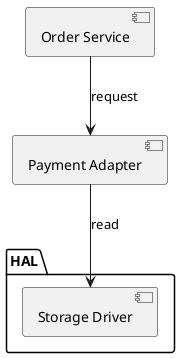

# UML Modelling Guide

This guide covers two jobs: drawing a code flow as UML, and reviewing that drawing. Load it when the task is "show me the flow" rather than "check this claim". Typical cases are reverse-engineering a handler, documenting a protocol, or auditing a diagram somebody else drew.

One rule runs through the whole guide. **A diagram is a model, and a model can be wrong.** A tidy flow chart is not evidence about the code. Worse, a diagram that disagrees with the model it came from will mislead every reader who trusts it.

## Choosing the view

The view follows the question, not the machine. Decide in this order.

**1. Is the question about where dependencies point?** Architecture, layering, module
structure, "may this call that" — that question belongs to the `model-everything-structure`
skill, which reads the same component, package, class or deployment text as a dependency
graph. The state front end refuses that text by name
(`UML_NOT_A_STATE_DIAGRAM`) instead of reviewing it.

**2. Otherwise fix the boundary first, then pick the view by the reader's question.**

| Situation | View that answers it |
|---|---|
| "What are the states of this handler, and what moves between them?" | State machine |
| "What does this function actually do, including its error paths?" | Activity (flow) |
| "In what order do these messages arrive, and what is the state after each?" | Sequence |
| "Somebody gave me a diagram. Is it right?" | Any view. Feed it to the review and compare it against the code. |
| "This diagram and this model disagree." | Feed both to the review. The round-trip check names every difference. |

**3. Check the choice against the next step.** A view that cannot feed the check you are
about to run is the wrong view, however readable it looks.

| Next step | Views that can feed it |
|---|---|
| `model_verify` (S1-S8 and A1-A14) | State or activity: `parse` reads either into a LogicModelV1 |
| `uml_review` with a model, for the fidelity check | State or activity: only those round-trip |
| `uml_review` with a model alone | Any view. With `kind: "sequence"` the trace is rendered and the fidelity check is reported inapplicable (`UML019`) |
| A human reading a protocol exchange | Sequence, which is the honest view there |

**4. Say that out loud, and the tool refuses a pairing that cannot serve it.** `intent`
declares what the artifact is for. The check runs before any work, so an impossible
pairing is a refusal with a code rather than a report about the wrong artifact.

| Intent | What it means | Actions that serve it | View it needs |
|---|---|---|---|
| `present` | a human is going to read the diagram | render, review | any view the notation can draw |
| `verify` | it must be parseable into a LogicModelV1 for the engine | render, parse, review | state or activity: a trace cannot be parsed back |
| `fidelity` | the point is the render-and-reparse proof | review | state or activity: only those round-trip |

| `errorCode` | What happened |
|---|---|
| `UML_INTENT_UNSERVABLE` | The view exists but cannot serve the intent — a sequence view for `verify` or `fidelity`. |
| `UML_VIEW_UNREPRESENTABLE` | The `(notation, view)` cell does not exist — PlantUML activity. |
| `UML_INTENT_MISMATCH` | The intent names something this action does not do — `fidelity` on render (render proves nothing), `present` or `fidelity` on parse (parse returns a model). |

Omitting `intent` changes nothing: a sequence view still renders, and a review of one
still reports `UML019`. The intent is an opt-in statement of purpose, and nothing infers
it.
When the question is still unclear, model the state machine. It is the safe default, and
the other views render from the same model afterwards.

### Nothing picks the view for you

`render` takes `kind` from the caller and defaults to `state`; it never guesses. A guess
between state and activity would be a presentation decision, and the machine cannot make
it: the same guarded branch is a state machine to one reader and an error path to another.
`parse` does detect the notation and the diagram family from the text, and it refuses the
families it cannot model, by name.

Mechanically decidable, and nothing else:

- the notation and the family the text declares — a Mermaid header (`stateDiagram`,
  `flowchart`, `sequenceDiagram`, or a known other-family header) or a PlantUML body
  keyword;
- whether the requested notation-and-kind combination exists at all (PlantUML has no
  activity view here);
- whether a view can carry the fidelity check (a sequence cannot).

Everything else is a fact about the question, not about the artifact. A model can tell you
its shape — its state count, its guarded branches, its cycles — and its shape does not
choose the view.

Do not use this guide for a behavioural claim about a specific machine. That is the job of
`model_verify` (S1-S8 and A1-A14). The review here covers the modelling, not the
behaviour. Every finding it produces names the engine check that settles the behavioural
half.

## The three views

One machine, three projections. They are not interchangeable. The review reports which view it saw, and the differences matter.

**State machine** (`stateDiagram-v2`, or a PlantUML state diagram). This view shows the whole topology: every state, every event-and-guard branch, and every terminal state as `--> [*]`. Model code flow into this view, and use it for review. It is the only view that round-trips without loss.

**Activity** (`flowchart TD` in Mermaid). This view draws the same machine as work rather than as states. Each edge carries `event [guard] / actions`. It suits a reader who thinks in steps. It holds the same information as the state view. PlantUML activity is **not** generated: its structured-flowchart syntax needs a while/if reconstruction for any graph with a merge or a cycle. A diagram that quietly reshapes the machine is exactly the failure this feature exists to prevent, so the tool refuses that combination.

**Sequence** (`sequenceDiagram`). This view shows one BFS trace: the messages in the order a walker meets them, with a note per state change. A trace is not a machine. Branches appear as separate guarded messages, paths the walk never took are absent, and the trace is capped. Use it to show a protocol exchange to a human. It cannot be the review's fidelity input, because `parse` refuses it and `review` reports the check as inapplicable (`UML019`).

## Modelling a code flow from source

Extraction follows the same discipline as `logic-verification-guide.md`, applied to code instead of a plan. That guide ships with the entry-point skill: `../model-everything/references/logic-verification-guide.md`.

1. **Fix the boundary.** Decide which function, task, or module is the machine. In scope: state the code holds across calls, such as statics, fields, enums, and task state variables. Out of scope: the call stack inside one invocation, hardware behaviour, and scheduler preemption.
2. **Name the states from the code.** A state exists if something survives a call boundary and is tested later. An enum, a `state` field, or a task-local variable that gates the next entry all qualify. A local variable inside one function does not.
3. **Name the events from the code.** Every edge must trace to a call site, a message, a timer expiry, or an ISR. An edge with no call site is a guess. Put it in the review findings instead of the model.
4. **Record guards and actions verbatim.** A guard must be the real condition, with the real variable and the real constant. A retry limit of 3 modelled as "a few" is a model of your assumption, not of the code.
5. **Mark the terminals.** An absorbing state is `terminal: true`. Examples are power-off, fatal, and done. If nothing is terminal, say so. The review will flag it either way.
6. **Write the narrative as you go.** The `narrative` block holds natural-language meanings for states and events, plus a scenario for each state-and-event pair. It is what lets a reader check the diagram against the code without re-deriving every symbol. Once the block is present, the schema requires all three parts and full coverage, so it cannot rot half-way.

### Evidence rule

Every state, event, guard and action needs a citation. Use `file:line` for code and a section reference for a document. A UML model without citations is a drawing. It cannot be reviewed, only admired. Present the citations together with the model.

### Confirming the model

The usual gate applies: show the extracted transition table or the diagram, and get confirmation before treating the model as fact. When the user has already told you to proceed without confirmation in this session, skip the question; instead cite evidence for every element, round-trip the model (render, parse, compare), and mark the result `UNCONFIRMED`.

## Rendering

In DSH:

```json
{ "action": "render", "model": { "...LogicModelV1..." }, "notation": "mermaid", "kind": "state" }
```

`uml_render` returns the diagram source plus `warnings`. Read those warnings. They list every construct the notation could not carry verbatim: a state id that needed an alias, a label containing `[` or `/`, a trace that was capped.

Without the DSH tool, run the repository engine on the same model JSON.

You can also write the diagram by hand. The generator is a convenience, not a requirement. A hand-written diagram is parsed and reviewed exactly like a generated one.

### Directives in generated diagrams

Generated text carries comment lines. Mermaid and PlantUML ignore them. The parser reads them:

```text
%%dsh-model-everything:uml v1 notation=mermaid diagram=state
%%dsh-model-everything:init INIT
%%dsh-model-everything:terminal FATAL
%%dsh-model-everything:alias S_1 1st state
%%dsh-model-everything:variable retry integer
```

These lines exist because the notation cannot express everything the model knows. `[*]` marks an initial state, but a flowchart has no such marker. A state id may contain characters the notation cannot spell. A boolean assignment (`armed := 1`) looks exactly like an integer one. Pinning those facts in comments is what makes the round-trip check exact instead of approximate. PlantUML uses `'` instead of `%%`.

A hand-written diagram needs none of these directives. Adding `%%dsh-model-everything:init` and `%%dsh-model-everything:terminal` to a flowchart is how you say which node starts and which one ends.

## Reviewing the modelling

```json
{ "action": "review", "model": { "...LogicModelV1..." } }
```

Four input shapes, four different questions:

| Input | Question answered |
|---|---|
| `model` only | Is this machine well-modelled? The review checks its structure, then renders and re-parses it to prove the diagram carries it. |
| `diagram` only | What does this diagram actually say? The diagram is parsed into a model, and that model is reviewed. Fidelity to code is **unchecked** (`UML018`). |
| `model` + `diagram` | Does the diagram match the model? Every structural difference is a modelling defect (`UML017`). |
| `model` + `kind: "sequence"` | The trace is rendered and the structure is reviewed, but the fidelity check **does not apply** (`UML019`). A trace cannot be parsed back into a machine, so the review says so instead of pretending it verified the diagram. `maxSteps` caps the trace. |

### Findings

| Code | Severity | What it means |
|---|---|---|
| `UML001_DIAGRAM_UNREADABLE` | error | The text is not readable as a Mermaid or PlantUML state or activity diagram. |
| `UML_NOT_A_STATE_DIAGRAM` | error | The text belongs to another diagram family. Numbers are reserved for `UML0xx` modelling findings, so this one carries a name instead; see [Structure diagrams are not models](#structure-diagrams-are-not-models). |
| `UML002_UNREACHABLE_STATE` | error | No transition can enter this state from init. The diagram draws flow nobody can reach. The check is structural and ignores guards; S1 is the guard-aware check. |
| `UML003_DEAD_END_STATE` | error | A non-terminal state has no outgoing transition. Either it is terminal, or the outgoing flow was never modelled. |
| `UML004_AMBIGUOUS_BRANCH` | error | Two unconditional arrows share one state and event. No reader and no implementation can resolve that. S4 is the authoritative check. |
| `UML005_OVERLAPPING_GUARD` | warning | The same guard text appears twice in one branch group. |
| `UML006_INEXHAUSTIVE_BRANCH` | warning or info | The branch group has only guarded branches and no default. The severity is `warning` when the guards do not look complementary. It is `info` when a complementary pair such as `k < 3` and `k >= 3` is present, which is probably exhaustive. Only S6 can settle it. |
| `UML007_UNUSED_EVENT` | warning | The event fires only from unreachable states. The diagram shows messages that never arrive. |
| `UML008_SELF_LOOP_NO_EXIT` | warning | An unguarded self-loop has no other exit. The diagram presents it as progress, but the flow never leaves. S3 reports absorbing cycles. |
| `UML009_DUPLICATE_TRANSITION` | warning | The same from, event, guard, actions and target row appears twice. |
| `UML010_UNUSED_VARIABLE` | warning | No guard reads this variable and no action writes it. It is a symbol with no source. |
| `UML011_UNBOUNDED_VARIABLE` | info | An integer variable has no min or max, so no range invariant can be checked and A5 has no declared domain. |
| `UML012_NO_TERMINAL` | warning | No state is terminal, so completion, failure and a stuck flow all look the same. |
| `UML013_NO_NARRATIVE` | info | The model carries no meanings, so a reader must re-derive every symbol from the source. Adding a partial narrative is a valid first step. |
| `UML027_NARRATIVE_PARTIAL` | info | The narrative covers part of the model. `narrativeCoverage` (also in the finding's `evidence`) reports `covered/total` per dimension — states, events, scenarios. Incomplete is not wrong. |
| `UML014_UNDOCUMENTED_STATE` | info | These states render as their bare id, so the diagram cannot be read against the code. |
| `UML015_LABEL_DRIFT` | warning | A diagram label disagrees with the model narrative. One of the two is stale, and the review cannot tell which. |
| `UML016_DIAGRAM_PARSE_NOTES` | info | Notes collected while rendering or reading the diagram. They mark information the notation could not carry. |
| `UML017_ROUND_TRIP_MISMATCH` | error | The diagram does not carry the model. Transitions were lost or invented, or init, terminals or variables differ. The `roundTrip.diffs` array lists each one. |
| `UML018_FIDELITY_UNCHECKED` | info | Only a diagram was supplied, so nothing here proves it matches the code. |
| `UML019_ROUND_TRIP_SKIPPED` | warning | The fidelity check could not run, either because the view is not round-trippable or because it was switched off. |

`ok: true` means the review ran. It does not mean the model is good. Read `verdict`, not `ok`:

| `verdict` | What it means | What to do |
|---|---|---|
| `pass` | No error and no warning finding. | Safe to present, with the scope the model covers. |
| `pass_with_findings` | No error finding, but warnings exist (e.g. `UML012_NO_TERMINAL`, `UML006`). | Present the pass **and** the warnings; do not upgrade it to "no issues". |
| `fail` | An error finding exists (`UML002`, `UML003`, `UML004`, `UML017`, `UML_NOT_A_STATE_DIAGRAM`, …) or the diagram could not be read (`ok: false`). | The diagram is **not** reviewed. Fix the error findings, or stop calling the file a model. |

`verdictReason` states why in one line (`2 error finding(s) (first: UML002_UNREACHABLE_STATE)`).
A refused call returns `ok: false` with an `errorCode` that says why; a review that ran and failed carries `verdict: fail` with its error findings.

### Structure diagrams are not models

This is the failure mode worth a section of its own, because it does not look like a failure.

A PlantUML component, package, class or deployment diagram declares no diagram kind —
it simply starts with `@startuml`. A state parser therefore meets its keywords line by
line, ignores the words it does not know, and reads the arrows as state transitions:



Before this contract existed, that parsed to `ok: true` with three "states" and two
"transitions", and "the structure diagram was reviewed" was pure fabrication. Now the
same input returns the by-product **plus**:

```json
{
  "verdict": "fail",
  "findings": [{ "code": "UML_NOT_A_STATE_DIAGRAM", "severity": "error",
                 "message": "the text is not a state or activity diagram: 4 declaration(s) of unsupported construct(s) (component ×3, package ×1) and 2 arrow(s) between them were read as states and transitions, so the parsed model is not this diagram." }],
  "discardedConstructs": [{ "construct": "component", "line": 2, "text": "component [Order Service] as SVC" }, "…"],
  "discardedEdges": 2
}
```

Read that as: **there is no model of this file.** Do not feed the by-product to
`model_verify` and call the result an architecture review, and do not quote its
"states" as dependencies. `discardedConstructs` lists every declaration that could not
be represented (with its line and text), and `discardedEdges` counts the arrows between
them that were misread.

Mermaid families with an explicit header — `classDiagram`, `erDiagram`, `gantt`,
`journey`, `mindmap`, `gitGraph`, `C4*`, `requirementDiagram`, `timeline`,
`quadrantChart`, `sankey-beta`, `block-beta`, `packet-beta`, `architecture-beta`,
`radar-beta`, `treemap-beta`, `xychart-beta` — are refused instead, because an empty
model would be worse than no model: the tool returns `ok: false` with
`errorCode: "UML_NOT_A_STATE_DIAGRAM"` naming the family, and `review` reports it as
`UML001_DIAGRAM_UNREADABLE`. Sequence diagrams are in the same class of refusal, for a
different reason (a trace cannot reconstruct a machine).

Both routes are non-pass and both name what was discarded. What the tool will **not**
do is hand back a plausible model with no verdict — that is the false guarantee.

**A structure diagram has its own reviewer.** Dependency-graph checks — isolated
nodes (`UML020`), dangling endpoints (`UML021`), cycles (`UML022`), disallowed edges
and layer violations against an allowed-dependency matrix (`UML023`, `UML024`) and
required-but-absent edges (`UML025`) — are implemented by the `model-everything-structure`
skill and the `uml_structure_verify` tool, which parse the same component,
package, class and deployment text into a real node/edge graph instead of discarding
it. Use that for architecture questions; this guide is about the state-machine half.

### Use case diagrams

A use case diagram is read as its own model (actors, use cases, associations, include,
extend, generalization), never as a machine. Its findings are these, and the severity
follows the source of the rule: an error is a UML 2.5 well-formedness constraint, while
a warning or an info is a completeness or style rule named by the tool that defines it.

| Code | Severity | What it means |
|---|---|---|
| `UML030_USE_CASE_NO_ACTORS` | error | No actor is declared, so the diagram does not say who uses the system. |
| `UML031_USE_CASE_NO_USE_CASES` | error | No use case is declared, so the diagram does not say what the system offers. |
| `UML034_DANGLING_RELATION_ENDPOINT` | error | A relation names an element the diagram never declares. The line points at nothing a reader can look up. |
| `UML035_INCLUDE_EXTEND_CYCLE` | error | Include and extend are cyclically dependent, so the use cases can never be performed in a finite order. The detail names the path. |
| `UML036_ACTOR_TO_ACTOR_ASSOCIATION` | error | An association joins two actors. Actors do not use each other: a shared role is a generalization, and shared behaviour belongs in a use case. |
| `UML037_ACTOR_INCLUDE_EXTEND` | error | An actor includes or extends a use case. Only use cases include or extend each other; an actor reaches a use case by an association. |
| `UML038_SELF_RELATION` | warning | An element relates to itself, which says nothing. |
| `UML032_ISOLATED_ACTOR` | info | An actor takes part in nothing. The tool rule that defines this check reports it at info, and an unused actor alone is not a modelling error: a diagram may be drawn before its use cases are. |
| `UML033_USE_CASE_WITHOUT_ACTOR` | warning | No actor reaches this use case, directly or through an include or extend, so nothing says who triggers it. |
| `UML039_USE_CASE_UNDOCUMENTED` | info | A use case carries neither a display label nor a narrative entry, so a reader cannot map the id back to the system. |

That table is the use case half of the review. It is not the review of the class,
object, package, component or deployment families: those reviews are the dependency
checks above, plus `UML040_STRUCTURE_NODE_UNDOCUMENTED` (info) when a node carries no
label. The per-family well-formedness constraints those diagrams have in the
specification are not implemented as findings — see the coverage table in the project
memory before claiming a structure diagram is clean.

### Timing diagrams

A timing diagram is an interaction against a clock: which participants exist, what state
each is in over time, and what they send each other. PlantUML is the only notation here
(`robust`, `concise`, `binary`, `clock` with a period, `analog`, `rectangle`); Mermaid
has no timing diagram, and the tool refuses by name instead of drawing something else.

The model is `TimingModelV1`: `lifelines`, `states`, `segments`, `messages`,
`constraints`, and an optional `unit` for the axis. Two rules follow from what the
notation can actually say, and both are enforced rather than assumed:

- **A segment has no end time.** A lifeline is a list of changes; the next change on the
  same lifeline *is* the end of the previous state. A model that also carried an end would
  be carrying a field the diagram cannot express, and the round trip would drop it.
- **A state exists only where the diagram shows it.** "Which id is this drawn label?" is
  answered by a `dsh-model-everything:timingState` directive, never by inventing a second
  state. A state declared in the model but drawn nowhere is `UML048`.

| Code | Severity | What it means |
|---|---|---|
| `UML042_TIMING_NO_LIFELINES` | error | No lifeline is declared, so there is no participant whose state over time the diagram could show. |
| `UML043_TIMING_EMPTY_LIFELINE` | warning | A lifeline carries no state change and no message: it is drawn but says nothing. |
| `UML044_TIMING_TIME_ORDER` | error | The segments are written out of time order, so an earlier state would end before it begins. Negative times are legal — the run-up before the moment the reader cares about; what is not legal is an axis that goes backwards. |
| `UML045_TIMING_SIMULTANEOUS_STATES` | error | One lifeline is put into two states at the same moment. A renderer keeps only the last, so the model says something the diagram cannot. |
| `UML046_TIMING_UNDECLARED_REFERENCE` | error | A message or a segment names an element no declaration introduced. PlantUML draws a bare timeline for it, which is how a typo stays invisible. |
| `UML047_TIMING_CONSTRAINT_RANGE` | error | A duration constraint ends before it starts. |
| `UML048_TIMING_STATE_UNUSED` | warning | A state is declared but no lifeline is ever monitored in it. |
| `UML049_TIMING_UNDOCUMENTED` | info | A lifeline or state carries no name a reader can map back to the system. |

What the module does **not** carry, and names in `discardedConstructs` rather than
dropping: participant blocks (`@WB` with per-lifeline times), anchor points
(`@XX as :name`), a state's comment or colour (`is Waiting : note`, `is Waiting #LightCyan`),
`highlight`, `note top of`, `scale`, date axes, `mode compact`, and the `has` state-order
declaration. Each is a real construct of the notation and none of them is a state or a
message, so they are reported by name. A clock's `pulse` and `offset` are reported the
same way: the model carries the period.

### Profile diagrams

A profile extends the metamodel: a package of stereotypes, the metaclasses they extend,
and the applications that put the profile to use. PlantUML draws one **approximately**,
and this family is the case where the honest answer is a one-way view:

- it has `metaclass` and `stereotype` elements and draws `class X <<stereotype>>`;
- it has **no** profile element and no ProfileApplication, so the profile package itself
  is never drawn;
- an **extension** and a **stereotype generalization** are both a `--|>` arrow.

That last one is why `uml_parse` refuses this family by name: reading the text back would
have to decide which fact each arrow carries, and the notation does not say. So the model
is the record and the drawing is a view of it:

| Action | What happens |
|---|---|
| `uml_render` with `kind: "profile"` | Draws the approximation, with an `UML_RENDER_APPROXIMATE_VIEW` warning that says what it cannot carry. Every fact the drawing cannot show (which arrow is an extension, its multiplicity and role, the applications) is written as a `dsh-model-everything:profileExtension` / `:profileApply` / `:profile` directive, so the text is a faithful record even though the picture is not. |
| `uml_parse` | Refused with `UML_VIEW_UNREPRESENTABLE` and the reason. Use the model. |
| `uml_review` with `model` and `diagramKind: "profile"` | Reviews the model. This works, and is the intended path. |
| `uml_review` with `diagram` | Returns one `UML018_FIDELITY_UNCHECKED` info finding saying the text was not read — not a pass, and not an error either. |

The model is `ProfileModelV1`: `profile`, `stereotypes`, `metaclasses`, `extensions`
(with the extension end's `multiplicity` and role `label`), `applications`, and
`generalizations` (kept apart from extensions, because they are different facts).

| Code | Severity | What it means |
|---|---|---|
| `UML050_PROFILE_NO_STEREOTYPES` | error | The profile declares no stereotype, so it extends the metamodel with nothing. |
| `UML051_PROFILE_UNUSED_STEREOTYPE` | warning | A stereotype extends no metaclass and specialises no stereotype: nothing in the profile uses it. |
| `UML052_PROFILE_EXTENSION_MISSING` | warning | A metaclass is declared that no stereotype extends, so the profile does not change it. |
| `UML053_PROFILE_GENERALIZATION_CYCLE` | error | The stereotype hierarchy is cyclic, so which stereotype is the general one has no answer. The `detail` names the path. |
| `UML054_PROFILE_UNDECLARED_REFERENCE` | error | An extension, generalization or application names an element no declaration introduced. |
| `UML055_PROFILE_APPLICATION_MISSING` | info | The profile is applied to no package: nothing says where it is meant to be used. |
| `UML056_PROFILE_UNDOCUMENTED` | info | The profile or a stereotype carries no name a reader can map back to the specification it extends. |

The checks read the model alone. Whether a profile is *right* for the metamodel it
extends is a question about the specification being profiled, and that is not answered
here. The specification's own constraints on profiles — an extension end's aggregation,
`isRequired`, the ProfileApplication correspondence — need the drawing to carry the
extension endpoints and the application, which this notation does not.

### Composite structure diagrams

A composite structure diagram is a classifier seen from the inside: the parts it is made of,
the ports on its boundary, and the connectors between them. PlantUML has no page for it, so
the drawing is an approximation built from the deployment diagram's vocabulary - and unlike
a profile, this one **reads back exactly**, because nesting, port direction and both
connector ends are all spelled.

| Action | What happens |
|---|---|
| `uml_render` with `kind: "composite-structure"` | Draws a nested element for the classifier, the nestable elements for its parts, `port`/`portin`/`portout` for its boundary, and arrows for the connectors. An `UML_RENDER_APPROXIMATE_VIEW` warning names what the notation cannot carry. |
| `uml_parse` | Reads it back. The round trip is measured, not assumed, and `uml_review` proves it every time it renders a model. |
| `uml_review` | Reports the family's own findings, and checks fidelity by rendering the model and reading it back. |

The model is `CompositeModelV1`: `self` (the classifier, with the keyword it is drawn with),
`parts`, `ports` (each with `in` / `out` / `inout`), and `connectors` (each end naming the
classifier, a port, or a part). There is no nesting: a part's inside is a second diagram.

| Code | Severity | What it means |
|---|---|---|
| `UML057_COMPOSITE_NO_PARTS` | error | The classifier is drawn as a composite structure but holds no part. |
| `UML058_COMPOSITE_PORT_UNCONNECTED` | warning | A port has no connector, so nothing reaches the classifier through it. |
| `UML059_COMPOSITE_CONNECTOR_ENDPOINT_MISSING` | error | A connector ends at a name the classifier never declares. |
| `UML060_COMPOSITE_DUPLICATE_PART` | error | A part is declared more than once, so a connector naming it is ambiguous. |
| `UML061_COMPOSITE_PORT_COLLISION` | error | A port shares its name with a part: a connector naming it cannot be read. |
| `UML062_COMPOSITE_UNDOCUMENTED` | info | The classifier or a part carries no name a reader can map back to the design. |

Two limits worth stating. Detection keys on a port declaration, so a composite structure
drawn without a single port is read as the component diagram it also is. And the
specification's own constraints on the decomposition - a part's type and multiplicity, a
port's required and provided interfaces, a connector's role names and end compatibility,
collaborations - need notation that does not exist here, so they are neither checked nor
guessed at.

### Communication diagrams

A communication diagram is a set of lifelines joined by links, with numbered messages
travelling along the links. PlantUML has no such diagram type - the page is a 404 - but the
drawing is expressible with the object diagram's vocabulary, because the sequence number is
just a label: `C --> O : 1: create`. So this family is drawn approximately and read back
exactly, like the composite structure.

| Action | What happens |
|---|---|
| `uml_render` with `kind: "communication"` | Objects for the lifelines, `--` arrows for the links, `-->` arrows for the messages with the number in the label. An `UML_RENDER_APPROXIMATE_VIEW` warning names what the notation cannot carry. |
| `uml_parse` | Reads it back. |
| `uml_review` | Reports the family's own findings, and proves fidelity by rendering the model and reading it back. |

The model is `CommunicationModelV1`: `lifelines` (an id, and either a `classifier` for a
`:Name:` or a `label`), `links` (what the diagram draws between lifelines), and `messages`
(a `sequence` string plus its two ends). Links and messages are kept apart because a link
with no message is a real thing to notice, and so is a message with no link to carry it.

| Code | Severity | What it means |
|---|---|---|
| `UML063_COMMUNICATION_NO_LIFELINES` | error | The diagram declares no lifeline. |
| `UML064_COMMUNICATION_LIFELINE_UNLINKED` | warning | A lifeline takes part in no link and no message. |
| `UML065_COMMUNICATION_MESSAGE_WITHOUT_LINK` | warning | A message travels between two lifelines the diagram draws no link between. |
| `UML066_COMMUNICATION_UNDECLARED_ENDPOINT` | error | A link or message names a participant the diagram never declares. |
| `UML067_COMMUNICATION_SEQUENCE_DUPLICATE` | error | A sequence number is used twice, so the order has two answers. |
| `UML068_COMMUNICATION_UNDOCUMENTED` | info | A lifeline carries no name a reader can map back to the design. |

One limit is worth stating. `1.1` reads in UML as a nested call of `1`, but that is a claim
about the design; the diagram draws a label. The model keeps the number as the string the
diagram wrote, and the review does not check the drawing order against it - the numbers are
the order, and the order they were drawn in is not a claim.

### Interaction overview diagrams

An interaction overview is a control-flow graph whose nodes are interactions: a start, a
decision, references to interactions, a stop. It is drawn here as a **Mermaid flowchart**
whose nodes name interactions and whose edges carry the branch conditions. Mermaid is the
only notation it is drawn in. PlantUML's activity syntax is the one place a `ref` step
exists, and this build refuses it, because a structured flowchart language cannot carry a
graph with merges or cycles.

| Action | What happens |
|---|---|
| `uml_render` with `kind: "interaction-overview"` | A `flowchart TD` with a start node, a reference drawn as `[/"Name"/]`, an inline interaction as `["Name"]`, a decision as a rhombus, and each branch condition as an edge label. |
| `uml_parse` | Refused. A flowchart node carries a *name* rather than the interaction it stands for, so reading one back would have to guess whether a node is a reference to another diagram, an inline interaction, or a plain step. |
| `uml_review` | Reviews the model, and renders it in Mermaid - the family's own notation - so the drawing comes back with the report. Fidelity is reported as unchecked, because the text cannot be read back. |

The model is `InteractionOverviewModelV1`: `nodes` (each with a `kind` of `initial`,
`final`, `decision`, `merge`, `interaction` or `reference`, and an `interaction` name for
the last two) and `edges` (each with an optional `condition`). Exactly one initial node is
required, and that is a validator refusal rather than a finding: every later check would be
reading a graph with no entry.

| Code | Severity | What it means |
|---|---|---|
| `UML069_OVERVIEW_NO_INITIAL` | error | No initial node. Refused by the validator before the review runs, so the review never reports it. |
| `UML070_OVERVIEW_NODE_UNREACHABLE` | error | A node is on no path from the initial node, so the overview does not run it. |
| `UML071_OVERVIEW_DECISION_ONE_BRANCH` | warning | A decision has one outgoing edge, so it does not decide anything. |
| `UML072_OVERVIEW_REFERENCE_UNDECLARED` | error | An edge names a node the overview never declares. |
| `UML073_OVERVIEW_NODE_WITHOUT_INTERACTION` | error | An interaction or reference node names no interaction. |
| `UML074_OVERVIEW_UNDOCUMENTED` | info | A node carries no name a reader can map back to the design. |

### What the round trip proves

It proves the diagram is a faithful rendering of the model:

- the same initial state
- the same set of states and terminal states
- the same transitions, with the same guards and actions
- the same variables and kinds

It does **not** prove the model matches the code. Only a citation-per-element comparison does that, as described under "Evidence rule". It also does not prove the machine is correct. That is the job of `model_verify`.

A failing round trip means the notation lost something. In practice that is a real finding: an unlabelled arrow, a guard the parser could not read, or a diagram that was hand-edited away from its model.

## Worked example

The code under review is a handshake that retries on timeout and gives up.

```text
INIT --power_ready--> STARTING
STARTING --ack--> ACTIVE
STARTING --timeout [retry < 3] / retry := retry + 1--> ERROR
STARTING --timeout [retry >= 3]--> FATAL (terminal)
ERROR --cooldown--> STARTING
```

Render it as a state machine, then review it. The review reports two modelling gaps:

```text
UML006_INEXHAUSTIVE_BRANCH (info)  guards look complementary on retry
UML013_NO_NARRATIVE       (info)  no state, event or scenario meanings
```

Neither is a behaviour bug. Add the narrative so a reader can check the diagram against the code, then run `model_verify` for S1-S8 and A1-A14.

Now delete the `ERROR --cooldown--> STARTING` arrow and review again. `ACTIVE` and `ERROR` become dead ends (`UML003`), and `cooldown` becomes an event that only fires from an unreachable state (`UML007`). The diagram still looks plausible. That is the whole point.

## Labels and comments: what the parser expects

Two things cause most of the friction with hand-written diagrams. Both are printed by the
tools themselves: `uml_explain_labels` returns the convention (pass
`notation: "plantuml"` for that flavour), Either one prints exactly the table below,
from the same rules the parser applies.

**1. State meanings, in the spellings the parser accepts.** A label carries a *meaning*
when it differs from the bare id. Accepted, in this order:

| Spelling | Example | Notes |
|---|---|---|
| bare id | `state "IDLE" as IDLE` | counts as **no** meaning: the state is reported undocumented (`UML014`) |
| `ID（meaning）` | `state "IDLE（waiting for power）" as IDLE` | what the renderer writes; full-width parentheses |
| `ID(meaning)` | `state "IDLE(waiting for power)" as IDLE` | accepted as well |
| a description line | `IDLE : waiting for power` | the same meaning in the other PlantUML spelling |
| a single-line note | `note right of IDLE : waiting for power` | read as the meaning, not as a comment |
| any other text | `state "waiting for power" as IDLE` | taken verbatim |

`UML015_LABEL_DRIFT` compares the *meaning* with `narrative.states[id]` character for
character: the wrapper (`ID（…）`) is stripped, the rest must match. A different wording is
still drift — the review cannot tell which side is stale. Writing no label is not drift;
it is `UML014_UNDOCUMENTED_STATE` (info).

**2. Comment lines.** The only comment lines the parser *consumes* are the `dsh-model-everything:`
directives the renderer writes (`%%dsh-model-everything:` in Mermaid, `'dsh-model-everything:` in PlantUML):
`uml v1 …`, `init ID`, `terminal ID`, `alias X id`, `variable NAME kind`. They are
ordinary comments to every renderer, which is why the diagram stays valid.

Everything else is notation chrome (skipped silently), an ignored line, or a reported
construct:

| Line | Behaviour |
|---|---|
| a `%%` / `'` comment that is not a directive | `UML_PARSE_IGNORED_LINE` warning — the line carried no statement |
| a multi-line `note … end note` block | its body is skipped (prose is not a state meaning) and the block is reported once in `discardedConstructs` |
| `@startuml`/`@enduml`, `stateDiagram-v2`, `direction`, `classDef`/`style`/`linkStyle`/`click`, `scale`, `skinparam`, `title`, `hide`, `autonumber` | skipped silently |
| anything else the parser cannot read | `UML_PARSE_IGNORED_LINE` warning, and the model is built from what it did read |

So the practical rule is: keep non-directive comments out of the diagram body (put render
commands and explanations around the diagram, not inside it), and give every state a
`ID（meaning）` label when the model carries a narrative — otherwise the diagram compares
as undocumented and a later drift check has nothing to compare against.

## Limits

- The review is **structural**. It evaluates no guard over any valuation. "Probably exhaustive" is a shape test, not a proof. S6 is the check that decides.
- Reachability ignores guards (`UML002`). A state reachable only under an unsatisfiable guard is a behaviour finding (S1 and S6), not a modelling one.
- Sequence diagrams are traces. They are neither round-tripped nor parsed. Reviewing one renders the trace, reports the structure findings, and marks the fidelity check inapplicable (`UML019`).
- PlantUML activity is refused by design, as described above.
- Renaming a state in the diagram does not rename it in the code. The review can only tell you the two disagree. Resolving it needs the source.
- The generated diagram is a faithful view of the **model**, never of the **program**. If the model is wrong, the diagram is wrong in exactly the same way.
